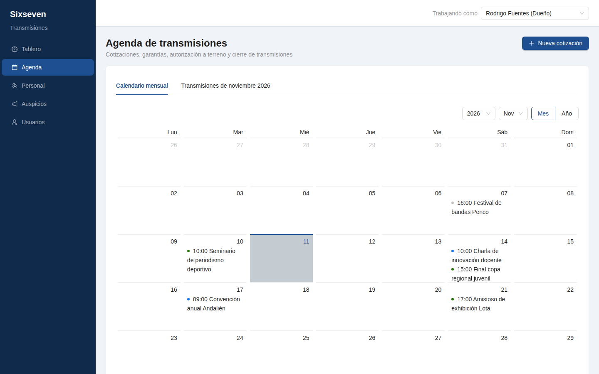
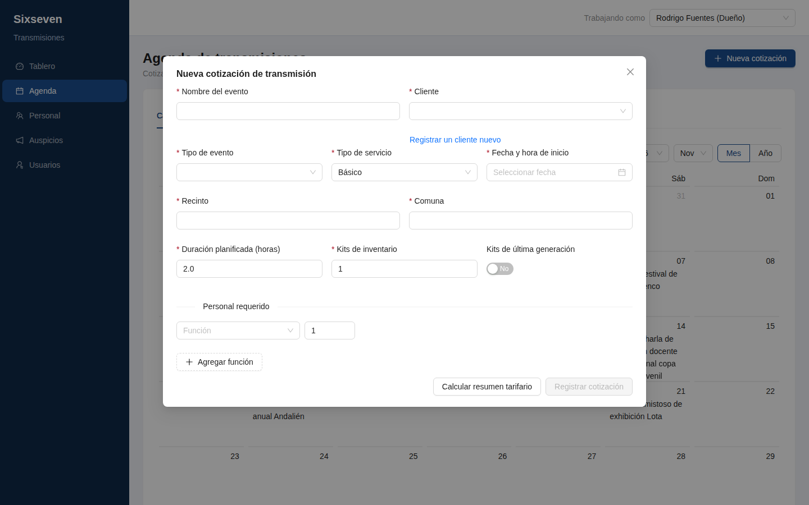
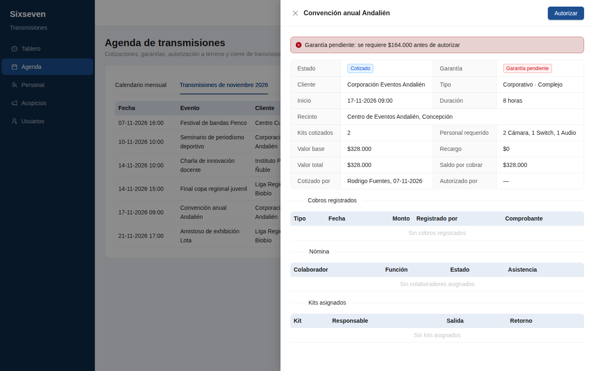
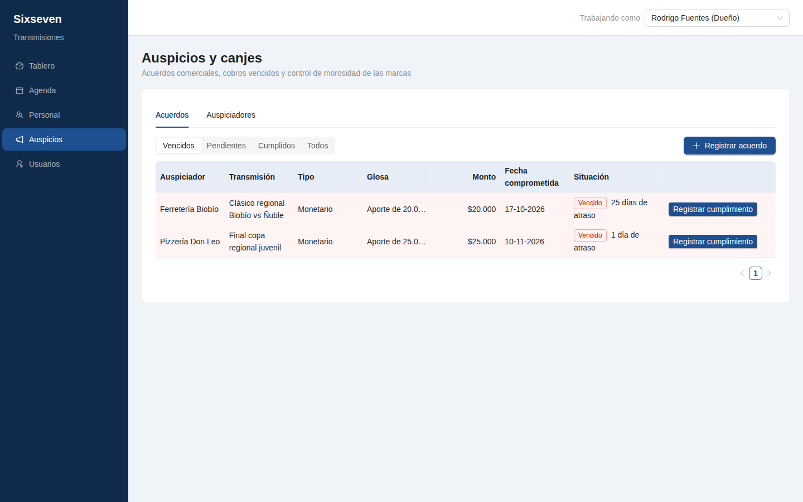
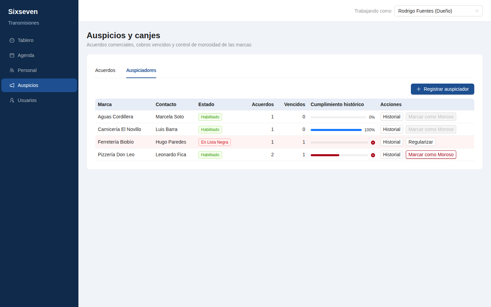

# Sixseven Transmisiones

Sistema web de gestión interna para **Sixseven Transmisiones LTDA.**, una empresa de producción técnica y transmisión en vivo de eventos deportivos, académicos, culturales y corporativos en las regiones del Biobío y Ñuble.

El sistema reemplaza el control manual de cotizaciones, garantías, autorizaciones y acuerdos con auspiciadores. Aplica las reglas del negocio de forma automática y deja registro de las acciones importantes.

Proyecto desarrollado para el ramo Ingeniería de Software (2026-2).



## Estado de los módulos

| Módulo | Estado | Contenido |
|---|---|---|
| **Agenda** | ✅ Disponible | Cotización, garantía, autorización a terreno, calendario y cierre |
| **Auspicios** | ✅ Disponible | Acuerdos, cumplimiento, vencidos, historial y lista negra |
| Personal | 🚧 En desarrollo | Colaboradores, disponibilidad, turnos y comisiones |
| Tablero | ⏳ Planificado | Indicadores por rol y reportes de gestión |
| Inventario | ⏳ Planificado | Equipos, kits, repuestos y logística de terreno |
| Financiero | ⏳ Planificado | Cobros, gastos, reembolsos y liquidaciones |
| Usuarios | ⏳ Planificado | Inicio de sesión y administración de cuentas |

Los módulos no disponibles aparecen en el menú con una página “En construcción”.

## Funcionalidades

### Agenda

- **Cotización con cálculo automático.** El valor se calcula a partir del personal requerido por hora, los kits de equipos y un recargo del 15 % si se usan kits de última generación. El Dueño revisa el resumen tarifario antes de guardar.
- **Garantía por adelantado.** Los eventos de más de 5 horas exigen una garantía del 50 % del valor, registrada por el Contador con su comprobante.
- **Autorización a terreno.** El sistema bloquea la autorización si falta la garantía requerida.
- **Calendario mensual.** Vista de calendario y listado con el estado de cada transmisión.
- **Cierre de transmisión.** Confirma la asistencia y la función efectiva de cada colaborador, siempre que los equipos hayan retornado a bodega.

Una transmisión avanza por los estados **Cotizado → Autorizado a Terreno → Finalizada**.

| Nueva cotización | Ficha de transmisión |
|---|---|
|  |  |

### Auspicios

- **Acuerdos monetarios o de canje** asociados a una transmisión.
- **Registro de cumplimiento** con la fecha y el monto o detalle recibido.
- **Consulta de vencidos e historial**, con días de atraso y porcentaje de cumplimiento por marca.
- **Lista negra.** Una marca con un acuerdo vencido puede marcarse como morosa, con motivo, y queda bloqueada para nuevos acuerdos.
- **Regularización.** Solo es posible cuando todos sus acuerdos vencidos están cumplidos. El antecedente se conserva en el historial.

| Acuerdos vencidos | Auspiciadores y lista negra |
|---|---|
|  |  |

## Roles

| Rol | Usuario de ejemplo | Acceso disponible |
|---|---|---|
| Dueño | Rodrigo Fuentes | Agenda (cotizar, autorizar, cerrar) y Auspicios |
| Contador | Carolina Muñoz | Agenda (consultar y registrar garantías) |
| Jefe Técnico | Matías Rivera | Sus módulos aún están en construcción |

## Tecnologías

| Capa | Herramientas |
|---|---|
| Cliente | React 18, Vite 5, Ant Design 5, React Router 6, Day.js |
| Servidor | Node.js, Express 5, Zod, Multer |
| Datos | PostgreSQL, Prisma 5 |
| Pruebas | Vitest |
| Producción | PM2 |

## Arquitectura

El cliente y el servidor son aplicaciones separadas que se comunican mediante una API REST. Una solicitud recorre estas capas:

```text
Página y componentes → Servicio del cliente → Ruta → Esquema → Controlador → Servicio → Base de datos
                                                                                ↑
                                                                  Reglas del negocio (utils)
```

Las reglas del negocio son funciones puras separadas de la base de datos, lo que permite probarlas de forma automática.

```text
.
├── client/
│   └── src/
│       ├── components/     Piezas de pantalla por módulo
│       ├── context/        Sesión de trabajo
│       ├── hooks/          Carga de datos y ejecución de acciones
│       ├── pages/          Una página por módulo
│       ├── services/       Llamadas a la API
│       └── utils/          Formatos, etiquetas y menú por rol
├── server/
│   ├── prisma/             Modelo de datos, migraciones y datos de ejemplo
│   ├── src/
│   │   ├── config/         Base de datos y subida de archivos
│   │   ├── controllers/    Reciben la solicitud y entregan la respuesta
│   │   ├── middlewares/    Sesión, validación y errores
│   │   ├── routes/         Direcciones de la API y permisos
│   │   ├── schemas/        Validación de datos
│   │   ├── services/       Operaciones sobre la base de datos
│   │   └── utils/          Reglas del negocio
│   └── tests/              Pruebas automáticas
└── docs/capturas/          Imágenes de este documento
```

## Instalación local

**Requisitos:** Node.js 20 o superior, npm y PostgreSQL con una base de datos vacía.

```bash
git clone https://github.com/Dust-Grimoire/Six-Seven-Transmisiones-V2.git
cd Six-Seven-Transmisiones-V2
```

Servidor:

```bash
cd server
npm install
cp .env.example .env
```

Edite `server/.env` con los datos de su base y luego cree las tablas y los datos de ejemplo:

```bash
npx prisma migrate reset --force
npm run dev
```

> ⚠️ `migrate reset` borra todo el contenido de la base indicada en `.env`. Úselo solo en su entorno local.

Cliente, en otra terminal:

```bash
cd client
npm install
npm run dev
```

Abra <http://localhost:5173>. El servidor responde en <http://localhost:3000/api/health>.

### Variables de entorno

| Archivo | Variable | Descripción |
|---|---|---|
| `server/.env` | `DATABASE_URL` | Conexión a PostgreSQL |
| `server/.env` | `PORT` | Puerto del servidor (3000 por defecto) |
| `server/.env` | `TZ` | Opcional. Zona horaria, por ejemplo `America/Santiago` |
| `client/.env` | `VITE_API_URL` | Dirección de la API. En desarrollo se usa `/api` |

### Comandos

| Carpeta | Comando | Función |
|---|---|---|
| `server/` | `npm run dev` | Inicia el servidor y lo reinicia al detectar cambios |
| `server/` | `npm start` | Inicia el servidor sin reinicio automático |
| `server/` | `npm test` | Ejecuta las pruebas |
| `client/` | `npm run dev` | Inicia el cliente en modo desarrollo |
| `client/` | `npm run build` | Compila el cliente en `client/dist` |
| `client/` | `npm test` | Ejecuta las pruebas |

## Cómo probar el sistema

Elija el perfil en el selector **“Trabajando como”**, en la esquina superior derecha. Los datos de ejemplo incluyen estos casos:

| Caso | Dónde | Resultado esperado |
|---|---|---|
| Autorizar sin garantía | Agenda → “Convención anual Andalién”, como Dueño | La autorización se rechaza |
| Registrar la garantía | La misma ficha, como Contador, por $164.000 con un comprobante | La garantía queda “Recibida” y el Dueño ya puede autorizar |
| Cerrar una transmisión | Agenda → “Seminario de periodismo deportivo”, como Dueño | Queda “Finalizada” al confirmar las asistencias |
| Consultar vencidos | Auspicios → Acuerdos | Aparecen los acuerdos vencidos con sus días de atraso |
| Marca en lista negra | Registrar un acuerdo con “Ferretería Biobío” | Se rechaza por estar En Lista Negra |
| Marcar como moroso | Auspicios → Auspiciadores → “Pizzería Don Leo” | Queda En Lista Negra, con motivo |

Las fechas de ejemplo se calculan a partir del día en que se cargan los datos.

## API

Todas las direcciones parten de `/api`. Mientras no exista el inicio de sesión, el usuario se indica con la cabecera `x-usuario-id` (`1` Dueño, `2` Contador, `3` Jefe Técnico).

```bash
curl -H "x-usuario-id: 1" "http://localhost:3000/api/auspicios/acuerdos?situacion=VENCIDO"
```

En PowerShell use `curl.exe` en lugar de `curl`.

### Agenda

| Método | Dirección | Rol | Función |
|---|---|---|---|
| POST | `/agenda/resumen-tarifario` | Dueño | Calcula el valor sin guardar |
| POST | `/agenda/transmisiones` | Dueño | Crea una cotización |
| GET | `/agenda/transmisiones?desde=&hasta=` | Dueño, Contador | Lista las transmisiones de un rango |
| GET | `/agenda/transmisiones/:id` | Dueño, Contador | Obtiene la ficha |
| POST | `/agenda/transmisiones/:id/garantia` | Contador | Registra la garantía |
| PATCH | `/agenda/transmisiones/:id/autorizar` | Dueño | Autoriza la salida a terreno |
| PATCH | `/agenda/transmisiones/:id/cerrar` | Dueño | Cierra la transmisión |

### Auspicios (solo Dueño)

| Método | Dirección | Función |
|---|---|---|
| GET | `/auspicios/auspiciadores` | Lista las marcas y su cumplimiento |
| POST | `/auspicios/auspiciadores` | Registra una marca |
| GET | `/auspicios/auspiciadores/:id` | Obtiene el historial de una marca |
| PATCH | `/auspicios/auspiciadores/:id/lista-negra` | Marca como moroso |
| PATCH | `/auspicios/auspiciadores/:id/regularizar` | Retira de la lista negra |
| GET | `/auspicios/acuerdos?situacion=` | Lista acuerdos. Filtros: `PENDIENTE`, `VENCIDO`, `CUMPLIDO` |
| POST | `/auspicios/acuerdos` | Registra un acuerdo |
| PATCH | `/auspicios/acuerdos/:id/cumplimiento` | Registra el cumplimiento |

### Códigos de respuesta

| Código | Significado |
|---|---|
| 400 | Los datos no son válidos |
| 401 | No se indicó un usuario activo |
| 403 | El rol no tiene permiso |
| 404 | El registro no existe |
| 409 | La operación va contra una regla del negocio |

## Pruebas

```bash
cd server && npm test
cd client && npm test
```

Las pruebas automáticas cubren las reglas tarifarias y de garantía, los vencimientos y el cumplimiento de acuerdos, las reglas de personal, los cálculos de fechas y los formatos del cliente.

## Producción

En producción se ejecutan dos procesos con PM2: la API (`node index.js` en `server/`) y el cliente compilado (`pm2 serve dist <puerto> --spa` en `client/`). Antes de compilar, `VITE_API_URL` debe contener la dirección pública completa de la API, porque el cliente en producción no tiene el proxy de Vite.

## Limitaciones conocidas

- **No hay inicio de sesión todavía.** El selector “Trabajando como” permite usar cualquier perfil sin contraseña. Es un mecanismo de demostración, por lo que esta versión no debe usarse con datos reales ni exponerse a internet.
- El cierre de una transmisión requiere registrar el retorno de sus equipos, lo que pertenece al módulo Inventario. Por ahora solo pueden cerrarse las transmisiones de los datos de ejemplo que ya tienen ese retorno.
- La asignación de personal a una transmisión será posible desde la pantalla cuando se complete el módulo Personal.

## Flujo de desarrollo

- `main` contiene las versiones entregadas y `dev` integra el trabajo en curso.
- Cada función se desarrolla en su propia rama (`feature/<funcion>`) creada desde `dev` y se integra mediante un Pull Request revisado.
- Los commits siguen el formato `tipo(alcance): descripción`.
